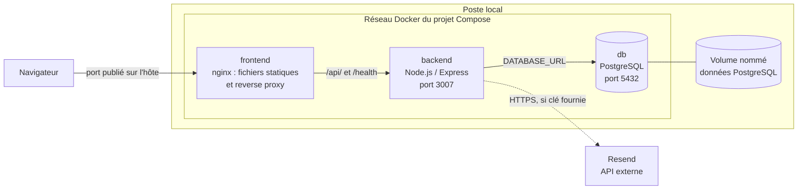

# 10 - Analyse préalable (Jalon 1)

Analyse du code fourni, réalisée avant l'écriture des Dockerfiles et du `docker-compose.yml`.
Elle répond à la mission d'analyse de la section 8 de la [documentation technique](08-documentation-technique.md).

## 1. Composants, rôles et dépendances

| Composant | Technologie | Rôle | Dépend de |
|---|---|---|---|
| Frontend | HTML, CSS, JavaScript, construit avec Vite | Affiche le quiz et la page d'administration | nginx pour être servi |
| nginx | Serveur web et reverse proxy | Sert les fichiers statiques et transmet `/api/` et `/health` au backend | Backend |
| Backend | Node.js, Express (`backend/server.js`) | API : inscription, résultats, administration, envoi d'emails | PostgreSQL, Resend |
| PostgreSQL | Base relationnelle | Stocke les utilisateurs, les résultats et les réponses | Volume persistant |
| Resend | Service externe | Envoi des résultats par email | Clé d'API |

### Frontend : Node.js sert à construire, pas à exécuter

`npm run build` lance `vite build`, qui produit des fichiers statiques (HTML, CSS, JS) dans `dist/`.
`vite.config.js` déclare deux pages : `index.html` (le quiz) et `gestion-quiz.html` (l'administration).

Conséquence pour la conteneurisation : un build en deux étapes (multi-stage).

1. Une étape Node.js qui exécute `npm ci` puis `npm run build`.
2. Une étape nginx qui ne reçoit que le contenu de `dist/` (`COPY --from=build /app/dist /usr/share/nginx/html`).

L'image finale ne contient ni Node.js, ni `node_modules`, ni le code source.

### Backend : commande de production

`backend/package.json` définit deux scripts :

| Script | Commande | Usage |
|---|---|---|
| `start` | `node server.js` | Production |
| `dev` | `node --watch server.js` | Développement : relance le serveur à chaque modification de fichier |

`--watch` est inutile dans une image, dont les fichiers ne changent pas.
Le conteneur lancera directement `node server.js` (forme exec, sans passer par npm).
Ainsi `node` est le processus n°1 du conteneur et reçoit le signal `SIGTERM` de `docker stop` : l'arrêt est immédiat et propre.
Avec `npm start`, c'est npm qui reçoit le signal et il ne le transmet pas toujours à node : Docker attend alors 10 secondes avant de forcer l'arrêt.

## 2. Ports

| Composant | Port dans le conteneur | Publié sur l'hôte | Justification |
|---|---|---|---|
| nginx (frontend) | 80 (`listen 80;`) | Oui | Seul point d'entrée du navigateur |
| Backend | 3007 (`process.env.PORT \|\| 3007`) | Non | Joint uniquement par nginx, sur le réseau Docker |
| PostgreSQL | 5432 | Non | Joint uniquement par le backend |

Le port 5173 est celui du serveur de développement Vite : il n'est pas utilisé en conteneur.

Seul le frontend est publié. Le backend et la base restent internes au réseau Docker, ce qui réduit la surface d'attaque.
Pour le débogage, la base reste accessible sans publication de port : `docker compose exec db psql -U <utilisateur> <base>`.

Point d'attention : écouter sur le port 80 exige les droits root (ports inférieurs à 1024).
Si l'image nginx tourne sans root (`nginx-unprivileged`), `nginx.conf` devra écouter sur 8080.
C'est une modification de configuration d'infrastructure, pas de logique métier.

## 3. Chemin d'une requête

Exemple avec l'inscription d'un utilisateur (`POST /api/users`) :

1. **Navigateur vers nginx.** `main.js` appelle `/api/users`, une URL relative (`const API_URL = "/api"`). La requête part donc vers le serveur qui a servi la page : nginx.
2. **nginx vers backend.** Le bloc `location /api/ { proxy_pass http://backend; }` transmet la requête au backend sur le port 3007.
3. **Backend vers PostgreSQL.** Express traite la route et interroge la base avec le pool de connexions `pg`, configuré par `DATABASE_URL`.

Le navigateur ne connaît jamais l'adresse du backend : c'est ce qui permet de ne pas le publier.

### Résolution du nom `backend`

```nginx
upstream backend {
    server backend:3007;
}
```

- `upstream backend` est un nom de groupe interne à nginx, réutilisé dans `proxy_pass http://backend;`.
- `server backend:3007` est un nom d'hôte résolu par DNS.

Dans Docker Compose, chaque service est enregistré dans le DNS du réseau du projet sous son **nom de service**.
Le service du backend doit donc s'appeler `backend`.
De même, le service PostgreSQL s'appellera `db`, nom utilisé dans `DATABASE_URL`.

Point à traiter pour Azure Container Apps (J4) : il n'y aura ni Compose ni service nommé `backend`. Cette ligne devra être adaptée au nom interne de l'application backend.

## 4. Variables d'environnement

| Variable | Utilisée par | Type | Remarque |
|---|---|---|---|
| `POSTGRES_USER` | PostgreSQL | Paramètre public | |
| `POSTGRES_DB` | PostgreSQL | Paramètre public | |
| `POSTGRES_PASSWORD` | PostgreSQL | **Secret** | |
| `DATABASE_URL` | Backend | **Secret** | Contient le mot de passe de la base |
| `RESEND_API_KEY` | Backend | **Secret** | Obligatoire au démarrage (voir section 7) |
| `ADMIN_USERNAME` | Backend | Paramètre public | À ne pas diffuser inutilement |
| `ADMIN_PASSWORD` | Backend | **Secret** | Valeur par défaut dangereuse dans le code |
| `JWT_SECRET` | Backend | **Secret** | Valeur par défaut dangereuse dans le code |
| `FROM_EMAIL` | Backend | Paramètre public | Facultative, valeur par défaut dans le code |
| `PORT` | Backend | Paramètre public | Facultative, 3007 par défaut |

### `DATABASE_URL` en local

`DATABASE_URL` n'est pas dans `.env.example` : elle est construite dans le compose à partir des autres variables.

```
postgres://${POSTGRES_USER}:${POSTGRES_PASSWORD}@db:5432/${POSTGRES_DB}
```

Compose remplace les `${...}` par les valeurs du fichier `.env`, qui n'est pas versionné. Le mot de passe n'apparaît donc pas dans le compose.

Limites connues :

- Un mot de passe contenant `@`, `:`, `/` ou `#` casse l'URL. Il faut l'encoder ou utiliser un mot de passe alphanumérique.
- La valeur finale reste lisible avec `docker compose config` et `docker inspect`. Ces sorties ne doivent pas figurer dans les preuves.

### Gestion des secrets

- En local : fichier `.env` non versionné (déjà exclu par `.gitignore`), et `.env.example` avec des valeurs fictives.
- Sur Azure : secrets de Container Apps pour les secrets, variables d'environnement simples pour les paramètres publics.

## 5. Base de données

### Schéma (`database/init.sql`)

```
users  ──<  quiz_results  ──<  answers
```

| Table | Contenu | Lien |
|---|---|---|
| `users` | Prénom, email, date de création | |
| `quiz_results` | Score, nombre de questions, date | `user_id` vers `users` |
| `answers` | Détail de chaque réponse, temps passé | `quiz_result_id` vers `quiz_results` |

Les clés étrangères utilisent `ON DELETE CASCADE` : supprimer un utilisateur supprime ses résultats et leurs réponses.
Deux index accélèrent les recherches par utilisateur et par résultat.

Les questionnaires ne sont pas en base : ils sont définis dans le code (`questions_docker.js`, `questions_devops.js`, etc.).

### Initialisation

Le backend ne crée pas les tables : il exécute directement des `INSERT` et des `SELECT`.
Sans initialisation, la première inscription échoue.

L'image officielle `postgres` exécute les fichiers `.sql` placés dans `/docker-entrypoint-initdb.d/`.
Deux façons d'y mettre `init.sql` :

| Méthode | Principe |
|---|---|
| Montage dans le compose | `./database/init.sql:/docker-entrypoint-initdb.d/init.sql:ro` |
| Image dédiée | `database/Dockerfile` avec `COPY init.sql /docker-entrypoint-initdb.d/` |

Règle importante : ces scripts ne s'exécutent **que si le dossier de données est vide**, c'est-à-dire au premier démarrage avec un volume neuf.

- Recréer le conteneur en gardant le volume ne rejoue pas le script.
- Modifier `init.sql` ensuite n'a aucun effet tant que le volume existe.
- `docker compose down -v` supprime le volume, donc toutes les données.

Pour la base cloud (Neon, J5), ce mécanisme n'existe pas : `init.sql` devra être exécuté manuellement avec `psql`.

### Persistance

Les données sont conservées dans un volume nommé. L'emplacement dépend de la version majeure de l'image :

| Version de l'image | Données (`PGDATA`) | Point de montage du volume |
|---|---|---|
| 17 et antérieures | `/var/lib/postgresql/data` | `/var/lib/postgresql/data` |
| 18 et suivantes | `/var/lib/postgresql/18/docker` | `/var/lib/postgresql` |

La version sera épinglée et le point de montage vérifié pour cette version.

Preuve prévue pour le J1 : enregistrer un résultat, `docker compose down` (sans `-v`), `docker compose up -d`, puis constater que le résultat est toujours présent.

## 6. Routes utiles pour les tests

| Route | Usage pour les tests | Dépend de la base |
|---|---|---|
| `GET /health` | Vérification de santé, renvoie `{"status":"ok"}` | Non |
| `POST /api/users` | Test d'intégration : inscription | Oui |
| `POST /api/results` | Test d'intégration : enregistrement d'un résultat | Oui |
| `POST /api/admin/login` | Authentification administrateur | Non |
| `GET /api/admin/results` | Vérification de la persistance | Oui |

`/health` n'exécute aucune requête SQL. Elle prouve que le processus Node répond, pas que l'application fonctionne de bout en bout.
Le pool `pg` n'ouvre de connexion qu'à la première requête : le backend démarre donc même sans base.

Conséquences :

- Pour le J4, `/health` peut répondre 200 sur Azure sans base cloud.
- Dans le compose, `/health` ne peut pas servir à attendre la base. Le service `db` aura son propre `healthcheck` (`pg_isready`) et le backend un `depends_on` avec `condition: service_healthy`.

## 7. Constats de sécurité et de démarrage

### Valeurs par défaut dangereuses

```js
const ADMIN_PASSWORD = process.env.ADMIN_PASSWORD || "admin123";
const JWT_SECRET = process.env.JWT_SECRET || "change-this-secret";
```

Ces valeurs sont dans le code source, donc publiques.

- Sans `ADMIN_PASSWORD`, n'importe qui peut se connecter à l'administration avec `admin` / `admin123`.
- Sans `JWT_SECRET`, un attaquant peut fabriquer lui-même un jeton administrateur valide.

Le code métier ne devant pas être modifié, la protection est assurée par l'infrastructure : la syntaxe `${VAR:?message}` de Compose fait échouer le démarrage si la variable est absente.

```yaml
JWT_SECRET: ${JWT_SECRET:?JWT_SECRET doit être défini dans .env}
```

La même vérification sera faite dans `scripts/deploy.sh` pour Azure.
Le secret JWT est généré aléatoirement : `openssl rand -hex 32`.

### Le backend ne démarre pas sans `RESEND_API_KEY`

Test réalisé : `node server.js` sans la variable. Le processus s'arrête avec l'erreur `Missing API key`.

Explication : `new Resend(process.env.RESEND_API_KEY)` est exécuté au chargement du fichier, avant `app.listen()`.
Le SDK Resend lève une exception si la clé est absente. Le serveur n'écoute donc jamais, et même `/health` est injoignable.

Ce n'est donc pas PostgreSQL qui peut bloquer le démarrage du backend, mais l'absence de la clé Resend.

Contournement sans modifier le code : fournir une valeur factice (`RESEND_API_KEY=re_placeholder`).
Le constructeur ne vérifie que la présence de la clé. L'envoi d'email échouera, mais il est entouré d'un `try/catch` qui se contente d'écrire l'erreur dans les logs.

Vérification :

```bash
RESEND_API_KEY=re_placeholder node server.js
curl http://localhost:3007/health
```

## 8. Architecture locale



Seul le frontend publie un port sur l'hôte. Le backend et la base ne sont joignables que sur le réseau Docker du projet.

## 9. Choix de conteneurisation retenus

| Choix | Justification |
|---|---|
| Frontend en multi-stage (Node puis nginx) | Image finale minimale, sans outils de build |
| Backend lancé par `node server.js` | Arrêt propre, npm inutile à l'exécution |
| Services nommés `backend` et `db` | Noms attendus par `nginx.conf` et `DATABASE_URL` |
| Un seul port publié (frontend) | Surface d'attaque réduite |
| Volume nommé pour PostgreSQL | Données conservées après recréation des conteneurs |
| `init.sql` exécuté par l'image `postgres` | Schéma créé automatiquement au premier démarrage |
| `healthcheck` sur `db` et `depends_on` conditionnel | Le backend démarre quand la base est prête |
| Secrets dans `.env` non versionné, variables obligatoires avec `${VAR:?}` | Aucun secret dans le dépôt, aucune valeur par défaut du code utilisée |
| Clé Resend factice si aucun accès fourni | Permet le démarrage du backend sans modifier le code |
