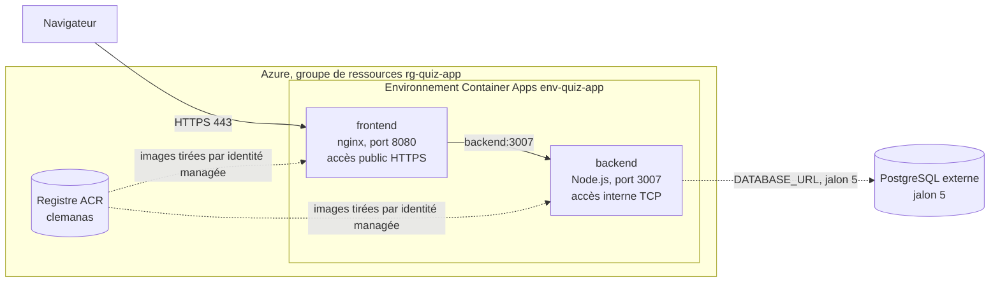

# 14 - Frontend et backend dans Azure Container Apps (Jalon 4)

Déploiement des deux applications conteneurisées sur Azure Container Apps, à partir des images du registre ACR.
Les sorties de commandes sont dans [preuves/J4/](../preuves/J4/).

## 1. Résultat

| Élément | Valeur |
|---|---|
| Application en ligne | https://frontend.salmonwave-d76adf8c.francecentral.azurecontainerapps.io |
| Test de santé du backend | `GET /health` répond HTTP 200 avec `{"status":"ok"}` |
| Images | `clemanas.azurecr.io/quiz-frontend:27bad84` et `clemanas.azurecr.io/quiz-backend:27bad84` |
| Base de données | Aucune à ce jalon (PostgreSQL cloud : jalon 5) |

## 2. Architecture cloud



| Ressource | Nom | Rôle |
|---|---|---|
| Environnement Container Apps | `env-quiz-app` | Réseau commun aux deux applications, frontière avec Internet |
| Application | `frontend` | nginx : fichiers statiques et reverse proxy. Seule application exposée |
| Application | `backend` | API Node.js. Joignable uniquement depuis l'environnement |

## 3. Configuration réseau

| Application | Accès | Transport | Port du conteneur | Joignable par |
|---|---|---|---|---|
| `frontend` | Externe | HTTP (HTTPS fourni par Azure) | 8080 | Internet, en HTTPS. Le HTTP est redirigé (301) |
| `backend` | Interne | TCP | 3007, exposé sur 3007 | Les applications du même environnement, sur `backend:3007` |

### Communication entre les deux applications

`nginx/nginx.conf` joint le backend par le nom d'hôte `backend` et le port 3007 :

```nginx
upstream backend {
    server backend:3007;
}
```

En local, `backend` est le nom du service Docker Compose.
Dans Azure Container Apps, les applications d'un même environnement se joignent par leur **nom d'application**.
Deux choix rendent la configuration nginx identique en local et dans le cloud :

- l'application s'appelle `backend` ;
- son accès interne est de type **TCP**, avec le port 3007 exposé tel quel.

Avec un accès interne de type HTTP, le backend aurait été joignable sur le port 80 de la passerelle de l'environnement, et non sur 3007. Il aurait fallu une configuration nginx différente pour le cloud.

Contrepartie connue : en TCP, le trafic entre le frontend et le backend n'est pas chiffré. Il reste à l'intérieur de l'environnement, qui n'est pas accessible depuis Internet.

### Le backend n'est pas exposé

Le backend n'a pas d'adresse publique : ses adresses internes répondent 404 depuis Internet.
`/health` est testé à travers le frontend, qui transmet la requête au backend (`location /health` dans `nginx.conf`).

## 4. Images et accès au registre

Les applications tirent leurs images du registre `clemanas` avec leur **identité managée** :

1. chaque application reçoit une identité créée et gérée par Azure (`--registry-identity system`) ;
2. cette identité reçoit le rôle `AcrPull` sur le registre, qui permet seulement de télécharger des images ;
3. Azure gère l'authentification : aucun mot de passe de registre n'existe, ni dans le script, ni dans la configuration des applications.

## 5. Variables d'environnement et secrets

| Variable du backend | Type | Source |
|---|---|---|
| `ADMIN_USERNAME` | Variable simple | `.env.azure` |
| `ADMIN_PASSWORD` | Secret `admin-password` | `.env.azure` |
| `JWT_SECRET` | Secret `jwt-secret` | `.env.azure` |
| `RESEND_API_KEY` | Secret `resend-api-key` | `.env.azure`, valeur factice |
| `DATABASE_URL` | Secret `database-url` | Ajoutée au jalon 5 |

- Les valeurs sensibles sont enregistrées comme **secrets Container Apps**. Les variables du conteneur y font référence (`secretref:`). La configuration de l'application n'affiche que le nom du secret.
- Les valeurs viennent du fichier `.env.azure`, exclu de Git. Le modèle [.env.azure.example](../.env.azure.example) ne contient que des valeurs fictives.
- Le script refuse de déployer si un secret manque ou a encore une valeur d'exemple. Le backend ne peut donc pas démarrer avec les valeurs par défaut publiques du code (`admin123`, `change-this-secret`).
- Les secrets du cloud sont différents de ceux du poste local.

Le frontend n'a ni variable ni secret.

## 6. Déploiement

```bash
cp .env.azure.example .env.azure    # puis remplacer les valeurs
scripts/deploy.sh
```

Prérequis supplémentaire par rapport au jalon 3 : l'extension `containerapp` d'Azure CLI (`az extension add --name containerapp`).

Étapes ajoutées à `scripts/deploy.sh` :

| Étape | Action |
|---|---|
| 1 | Lit et contrôle les secrets de `.env.azure` |
| 6 | Crée l'environnement Container Apps, s'il n'existe pas |
| 7 | Crée ou met à jour l'application `backend` |
| 8 | Crée ou met à jour l'application `frontend` |
| 9 | Teste `/health` à travers le frontend et échoue si la réponse n'est pas 200 |

Le backend est créé avant le frontend : nginx refuse de démarrer s'il ne peut pas résoudre le nom `backend`.

Le script est réexécutable. Si les applications existent, il met à jour leur image, ce qui crée une nouvelle révision.

### Ressources et mise à l'échelle

| Application | CPU | Mémoire | Réplicas | Raison |
|---|---|---|---|---|
| `backend` | 0,25 | 0,5 Gio | 1 à 1 | Toujours prêt : nginx n'attend que 5 secondes la connexion au backend |
| `frontend` | 0,25 | 0,5 Gio | 0 à 2 | S'éteint sans visite, se rallume à la première requête |

## 7. État des révisions

| Application | Révision | État | Santé | Trafic |
|---|---|---|---|---|
| `backend` | `backend--0000001` | En cours d'exécution | Healthy | 100 % |
| `frontend` | `frontend--0000001` | En cours d'exécution | Healthy | 100 % |

Chaque changement d'image ou de configuration crée une nouvelle révision. En mode révision unique, celui par défaut, Azure bascule le trafic sur la nouvelle révision quand elle est saine, puis désactive l'ancienne.

## 8. Diagnostic : le backend démarre-t-il sans base de données ?

**Oui.** Le backend a été déployé sans `DATABASE_URL`. Constat :

| Test | Résultat |
|---|---|
| Démarrage | `Server running on port 3007`, aucun redémarrage |
| `GET /health` | HTTP 200, `{"status":"ok"}` |
| `POST /api/admin/login` avec le secret Azure | HTTP 200 |
| `POST /api/admin/login` avec `admin123` | HTTP 401 |
| `POST /api/users` (inscription) | HTTP 500 |

Journal du backend lors de l'inscription :

```
Error creating user: Error: connect ECONNREFUSED 127.0.0.1:5432
```

Explications :

- Le pool de connexions `pg` est créé au démarrage, mais il n'ouvre une connexion qu'à la première requête SQL. L'absence de base ne bloque donc pas le démarrage.
- Sans `DATABASE_URL`, le pilote `pg` utilise ses valeurs par défaut : `127.0.0.1:5432`. Rien n'écoute à cette adresse dans le conteneur, d'où `ECONNREFUSED`.
- Les routes qui n'utilisent pas la base fonctionnent : `/health` et la connexion administrateur, qui compare les identifiants aux variables d'environnement.
- L'erreur est capturée par la route : elle renvoie 500 et le processus continue.

**La vraie dépendance bloquante au démarrage est `RESEND_API_KEY`**, pas PostgreSQL.
Sans cette variable, `new Resend(...)` lève `Missing API key` avant `app.listen()`, et même `/health` est injoignable (constaté au jalon 1).
Une valeur factice suffit à lever ce blocage.

Limite du test `/health` : il prouve que le processus répond, pas que l'application fonctionne. Une inscription réussie n'est possible qu'avec la base, au jalon 5.

## 9. Difficulté rencontrée : environnement « Express »

Le premier déploiement a échoué à la création du backend :

```
(ExpressTcpIngressNotSupported) TCP Ingress is not supported for container app 'backend' on express environments.
```

Cause : sans indication, Azure CLI a créé l'environnement en mode **Express**, un mode simplifié qui n'accepte pas l'accès TCP.
Correction : l'environnement est créé avec `--environment-mode WorkloadProfiles` (paramètre `ACA_ENV_MODE` de `scripts/config.sh`).
L'environnement Express, encore vide, a été supprimé puis recréé dans le bon mode.

## 10. Coûts

| Ressource | Facturation |
|---|---|
| Environnement | Pas de coût fixe en consommation, sans espace Log Analytics |
| `backend` | Un réplica permanent de 0,25 CPU et 0,5 Gio, facturé à la seconde |
| `frontend` | Facturé seulement quand il tourne |
| Registre ACR | Tarif fixe par jour |

Un quota mensuel gratuit de Container Apps couvre une partie de la consommation.
Pour réduire le coût entre deux séances : `BACKEND_MIN_REPLICAS=0 scripts/deploy.sh`, au prix d'un démarrage à froid.
`scripts/destroy.sh` supprime tout.

## 11. Suite

- Jalon 5 : ajouter `DATABASE_URL` dans `.env.azure` et relancer `scripts/deploy.sh`.
- Jalon 6 : la CI/CD publiera les images et mettra à jour les deux applications après fusion dans `main`.
