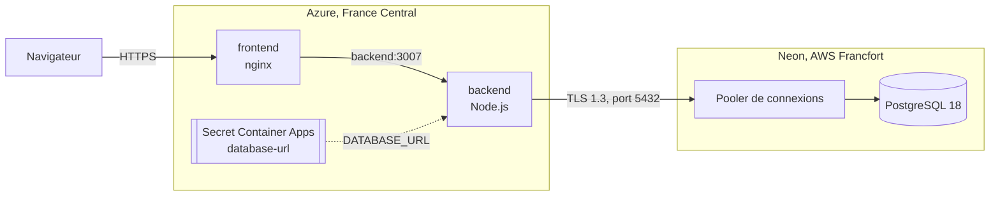

# 15 - PostgreSQL cloud (Jalon 5)

Connexion du backend déployé sur Azure à une base PostgreSQL externe, initialisation du schéma et preuve de la persistance.
Les sorties de commandes sont dans [preuves/J5/](../preuves/J5/).

## 1. Résultat

| Élément | Valeur |
|---|---|
| Fournisseur | Neon, plan gratuit |
| Version | PostgreSQL 18.7 |
| Région | AWS Europe (Francfort), `eu-central-1` |
| Connexion | Chiffrée, TLS 1.3 |
| Schéma | Tables `users`, `quiz_results`, `answers` créées par `database/init.sql` |
| Fonctionnement | Inscription et enregistrement d'un résultat validés sur l'application en ligne |

La base PostgreSQL locale de Docker Compose est conservée : elle sert au développement, Neon sert au cloud.

## 2. Architecture



- L'application est chez Azure, la base chez Neon, hébergé sur AWS. Les deux ne sont reliés que par la chaîne de connexion.
- Le trafic entre le backend et la base passe par Internet : il doit être chiffré.
- La région de Francfort est la plus proche de France Central parmi celles proposées par Neon.

## 3. Connexion chiffrée

### Exigences du pilote

Le backend utilise le pilote `pg` (node-postgres) 8.23.1. Il lit la chaîne de connexion dans `DATABASE_URL` :

```js
const pool = new pg.Pool({ connectionString: process.env.DATABASE_URL, ... });
```

Le code ne contient aucune option TLS. Le chiffrement dépend donc uniquement de la chaîne de connexion : elle doit contenir `sslmode=require`.

Avec cette version du pilote, `sslmode=require` est traité comme `verify-full` :
la connexion est chiffrée **et** le certificat du serveur est vérifié (autorité de certification et nom d'hôte).
C'est plus strict que le `require` de PostgreSQL, qui chiffre sans vérifier le certificat.
Le backend l'indique dans ses journaux par un avertissement, qui annonce un changement de comportement dans la prochaine version majeure du pilote.
Aucune modification du code n'a été nécessaire : le certificat de Neon est émis par une autorité reconnue.

### Vérifications

| Vérification | Résultat |
|---|---|
| Connexion avec `sslmode=require` | `SSL Connection: true`, TLS 1.3, chiffrement `TLS_AES_256_GCM_SHA384` |
| Connexion avec `sslmode=disable` | Refusée par le serveur : `connection is insecure` |
| Journaux du backend | Aucune erreur de connexion, requêtes SQL réussies |

Le chiffrement est imposé des deux côtés : la chaîne de connexion le demande, et Neon refuse toute connexion en clair.
`scripts/init-db.sh` refuse aussi une chaîne sans `sslmode=require`.

## 4. Initialisation du schéma

En local, l'image PostgreSQL exécute `database/init.sql` au premier démarrage.
Ce mécanisme n'existe pas chez Neon : les tables n'apparaissent pas automatiquement.
Sans initialisation, l'inscription échouerait avec `relation "users" does not exist`.

```bash
scripts/init-db.sh
```

| Étape du script | Détail |
|---|---|
| Lecture de `DATABASE_URL` | Dans `.env.azure`, ou dans une variable d'environnement |
| Contrôles | La chaîne commence par `postgres://` et impose TLS |
| Connexion | Affiche la version du serveur et les paramètres TLS |
| Schéma | Applique `database/init.sql` dans une seule transaction, si la table `users` n'existe pas |
| Vérification | Liste les tables |

- Le script utilise `psql` dans un conteneur : aucun client PostgreSQL à installer sur le poste.
- Il est réexécutable : si les tables existent, il ne modifie rien.
- Le même fichier `init.sql` sert en local et dans le cloud : les deux bases ont le même schéma.
- La transaction unique évite un schéma à moitié créé en cas d'erreur.

## 5. Gestion des secrets

La chaîne de connexion contient le mot de passe de la base : c'est un secret.

| Lieu | Forme |
|---|---|
| Poste de déploiement | Fichier `.env.azure`, exclu de Git par `.gitignore` |
| Azure | Secret Container Apps `database-url` |
| Conteneur du backend | Variable `DATABASE_URL`, qui référence le secret (`secretref:database-url`) |
| Dépôt Git | Absente. Le modèle `.env.azure.example` ne contient que la forme attendue |

- `scripts/deploy.sh` lit la valeur dans `.env.azure` et la transmet à Azure. Il ne l'affiche jamais.
- `scripts/init-db.sh` transmet la variable au conteneur `psql` sans l'écrire sur la ligne de commande.
- La configuration de l'application n'affiche que le nom du secret, jamais sa valeur.
- Les preuves du dépôt sont expurgées : chaîne de connexion et nom d'hôte de la base masqués.

Un changement de secret seul ne redémarre pas le backend : il faut une nouvelle révision. `deploy.sh` en crée une à chaque exécution.

## 6. Déploiement

```bash
# 1. Renseigner DATABASE_URL dans .env.azure (chaîne "pooled" fournie par Neon)
# 2. Créer les tables
scripts/init-db.sh
# 3. Transmettre la chaîne au backend et créer une nouvelle révision
scripts/deploy.sh
```

La chaîne utilisée est celle du **pooler** de Neon, dont le nom d'hôte contient `-pooler`.
Le backend ouvre jusqu'à 20 connexions par réplica (`max: 20` dans `server.js`). Le pooler les regroupe vers la base, dont le nombre de connexions est limité sur le plan gratuit.

## 7. Tests fonctionnels et persistance

Tests réalisés sur l'application en ligne, à travers le frontend.

| Action | Requête | Résultat |
|---|---|---|
| Inscription | `POST /api/users` | 201, utilisateur créé |
| Enregistrement d'un résultat | `POST /api/results` | 201, résultat et réponses enregistrés |
| Consultation par l'administration | `GET /api/admin/results` | Le résultat est listé |

### Persistance

| Étape | Constat |
|---|---|
| Avant | La base contient les utilisateurs, un résultat et deux réponses |
| Redémarrage de la révision du backend | Le conteneur est détruit, un nouveau réplica est créé |
| Après | Mêmes données en base, même résultat affiché par l'application |

Dans le cloud, le backend ne stocke rien : toutes les données sont dans Neon.
Les conteneurs peuvent être détruits, recréés ou multipliés sans perte.
C'est l'équivalent du volume Docker du jalon 1, déplacé dans un service managé.

Deux utilisateurs sont présents en base pour un seul résultat : une inscription a été faite sans terminer de quiz.

## 8. Points d'attention

| Point | Explication |
|---|---|
| Mise en veille de Neon | Sur le plan gratuit, la base se met en veille après quelques minutes sans activité et se réveille à la première connexion |
| Délai de connexion du backend | `connectionTimeoutMillis: 2000` dans `server.js` : si le réveil dépasse 2 secondes, la première requête peut échouer (500) et la suivante réussir. Non observé pendant les tests |
| `/health` ne teste pas la base | Un `/health` à 200 ne prouve pas que la base est joignable (voir jalon 4) |
| Avertissement du pilote sur `sslmode` | Informatif. Pour figer le comportement actuel, la chaîne peut utiliser `sslmode=verify-full` |
| Envoi d'emails | Toujours inactif (clé Resend factice) : le résultat est enregistré, l'email n'est pas envoyé |

## 9. Nettoyage

`scripts/destroy.sh` supprime les ressources Azure, pas la base Neon.
Le projet Neon se supprime depuis sa console (**Settings**, puis **Delete project**).
