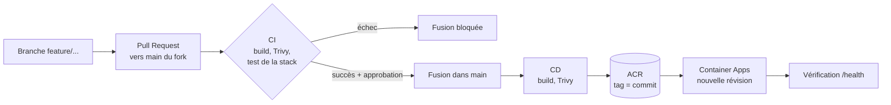

# 16 - CI/CD avec GitHub Actions (Jalon 6)

Chaîne de livraison du projet : contrôles automatiques sur chaque Pull Request, puis publication des images et déploiement après fusion dans `main`.
Les preuves sont dans [preuves/J6/](../preuves/J6/).

## 1. Vue d'ensemble

| Workflow | Fichier | Déclencheur | Rôle |
|---|---|---|---|
| CI | [.github/workflows/ci.yml](../.github/workflows/ci.yml) | Pull Request vers `main` | Contrôler le code avant fusion |
| CD | [.github/workflows/cd.yml](../.github/workflows/cd.yml) | Push sur `main`, donc après fusion | Publier et déployer |

## 2. J6-A : CI sur Pull Request

### Jobs

| Job (nom du contrôle) | Contenu | Échoue si |
|---|---|---|
| `Build et scan Trivy (backend)` | Construit l'image du backend, l'analyse avec Trivy | Le build échoue, ou Trivy trouve une CRITICAL |
| `Build et scan Trivy (frontend)` | Construit l'image du frontend, l'analyse avec Trivy | Le build échoue, ou Trivy trouve une CRITICAL |
| `Test de la stack Docker Compose` | Démarre les trois services et teste le parcours principal | Un service n'est pas sain, ou un test échoue |

### Scan Trivy bloquant

Le job appelle [scripts/scan-trivy.sh](../scripts/scan-trivy.sh), le même script qu'en local (jalon 2) :

1. il produit le rapport complet, publié comme artefact de l'exécution ;
2. il relance Trivy avec `--severity CRITICAL --exit-code 1` ;
3. si une CRITICAL est trouvée, le script sort en erreur, donc l'étape échoue, donc le job échoue.

Aucun `continue-on-error` n'est utilisé : le résultat du scan ne peut pas être ignoré.
Trivy s'exécute sur l'image **construite pendant le job**, pas sur une image déjà publiée.

### Test de la stack

| Test | Ce qu'il vérifie |
|---|---|
| `docker compose up --wait` | Les trois services deviennent `healthy` |
| `GET /health` à travers nginx | La chaîne frontend vers backend |
| `GET /` et `/gestion-quiz` | Le build du frontend |
| `POST /api/users` | L'écriture en base, donc le schéma `init.sql` |
| Connexion avec `admin123` refusée (401) | Les valeurs par défaut du code ne sont pas utilisées |

Le fichier `.env` de ce job est généré à chaque exécution avec des valeurs aléatoires jetables.

### Sécurité de la CI

| Mesure | Raison |
|---|---|
| Aucun secret utilisé | La CI s'exécute sur du code pas encore relu, y compris celui d'un contributeur externe |
| `permissions: contents: read` | Le jeton GitHub du job ne peut que lire le code |
| Pas de déploiement | Une Pull Request n'est jamais déployée dans l'environnement cible |
| Actions épinglées par identifiant de commit | Un tag d'action peut être déplacé vers un code malveillant, un commit non |
| Image Trivy épinglée par digest | Même raison |

## 3. Protection de la branche `main`

À configurer dans le fork : **Settings**, **Rules**, **Rulesets** (ou **Branches**, **Add branch protection rule**).

| Règle | Valeur |
|---|---|
| Branche ciblée | `main` |
| Require a pull request before merging | Activé |
| Required approvals | 1, si un second membre a les droits sur le dépôt |
| Require status checks to pass | Activé, avec les trois contrôles de la CI |
| Block force pushes | Activé |
| Restrict deletions | Activé |

Les contrôles obligatoires ne peuvent être sélectionnés qu'après une première exécution de la CI : GitHub ne propose que les contrôles qu'il a déjà vus.

État réel de la protection et restrictions éventuelles : voir [preuves/J6/](../preuves/J6/).

## 4. J6-B : CD après fusion dans `main`

### Étapes

| # | Étape | Détail |
|---|---|---|
| 1 | Paramètres | Noms des ressources lus dans `scripts/config.sh` ; tag = 7 premiers caractères du commit |
| 2 | Construction | Images du backend et du frontend, à partir du commit fusionné |
| 3 | Scan Trivy | Bloquant sur CRITICAL : une image vulnérable n'est pas publiée |
| 4 | Connexion à Azure | OIDC, sans secret |
| 5 | Publication | `docker push` vers `clemanas.azurecr.io` |
| 6 | Mise à jour | `az containerapp update --image`, backend puis frontend |
| 7 | Vérification | `/health` doit répondre 200 ; affichage des révisions actives et de leur image |

- **Tag traçable.** L'image porte l'identifiant du commit fusionné. `latest` n'est pas utilisé.
- **Nouvelle révision.** Chaque changement d'image crée une révision Container Apps. Azure y bascule le trafic quand elle est saine.
- **Pas de déploiement inutile.** Une modification limitée à `docs/`, `preuves/` ou à un fichier Markdown ne déclenche pas le CD.
- **Un déploiement à la fois.** Deux fusions rapprochées sont déployées l'une après l'autre.
- **Secrets de l'application inchangés.** Le CD ne change que l'image. Les secrets du backend (`DATABASE_URL`, etc.) restent ceux posés par `scripts/deploy.sh`.

### Ce que le CD prouve, et ce qu'il ne prouve pas

Le CD prouve la construction, la publication et la création d'une révision saine dont `/health` répond.
`/health` n'interroge pas la base : la disponibilité de PostgreSQL se vérifie par une inscription sur l'application (jalon 5).

## 5. Authentification du pipeline auprès d'Azure

Le pipeline se connecte à Azure par **OIDC**, sans mot de passe ni clé stockée dans GitHub.

1. À chaque exécution, GitHub délivre au job un jeton signé qui indique le dépôt et la branche.
2. Azure fait confiance à ce jeton pour une identité managée dédiée, `id-quiz-github`.
3. Azure remet au job un jeton d'accès valable le temps de l'exécution.

Mise en place : [scripts/setup-github-oidc.sh](../scripts/setup-github-oidc.sh).

| Élément | Valeur |
|---|---|
| Identité | Identité managée `id-quiz-github`, dans `rg-quiz-app` |
| Lien de confiance | Limité au sujet `repo:clementraoult@<id>/eval-quiz-app@<id>:ref:refs/heads/main` |
| Conséquence | Une Pull Request, une autre branche ou un autre dépôt ne peuvent pas obtenir de jeton Azure |

Le sujet doit correspondre exactement à celui du jeton présenté par GitHub.
GitHub y ajoute les identifiants numériques du propriétaire et du dépôt, qui ne changent jamais : un dépôt recréé plus tard sous le même nom n'obtiendrait pas la confiance d'Azure.
Le script lit ces identifiants sur l'API GitHub pour construire le sujet.

### Droits de l'identité

| Rôle | Portée | Utilité |
|---|---|---|
| `Reader` | Groupe de ressources | Retrouver les ressources |
| `AcrPush` | Registre `clemanas` | Publier les images |
| `Container Apps Contributor` | Application `backend` | Mettre à jour son image |
| `Container Apps Contributor` | Application `frontend` | Mettre à jour son image |

L'identité ne peut ni créer ni supprimer de ressources, ni modifier le registre ou l'environnement.

### Variables du dépôt GitHub

| Variable | Contenu |
|---|---|
| `AZURE_CLIENT_ID` | Identifiant de l'identité managée |
| `AZURE_TENANT_ID` | Identifiant de l'organisation Azure |
| `AZURE_SUBSCRIPTION_ID` | Identifiant de l'abonnement |

Ce sont des identifiants, pas des secrets : sans le jeton signé par GitHub pour la bonne branche, ils ne donnent aucun accès.
Ils sont déclarés comme **variables** du dépôt. Aucun secret GitHub n'est nécessaire à ce pipeline.

Une identité managée a été préférée à une inscription d'application Entra ID : elle se crée comme une ressource Azure ordinaire, sans droits particuliers sur l'annuaire de l'organisation, et disparaît avec le groupe de ressources.

## 6. Scénario de démonstration

1. Créer une branche `feature/...` depuis `main` du fork.
2. Modifier une question existante, par exemple dans `questions_docker.js`.
3. Pousser la branche et ouvrir une Pull Request vers `main` **du fork**.
4. La CI s'exécute : build des images, scan Trivy, test de la stack.
5. Après succès des contrôles et approbation, fusionner.
6. Le CD s'exécute : images publiées dans ACR, nouvelles révisions.
7. Vérifier la question modifiée sur l'application en ligne.

Les questionnaires sont compilés dans l'image du frontend : la question modifiée n'apparaît que si cette image a été reconstruite et déployée. Elle prouve donc que toute la chaîne a fonctionné.

### Démonstration du contrôle bloquant

Scénario contrôlé, sans publier d'image vulnérable :

1. sur une branche de test, retirer `apk upgrade --no-cache` du `Dockerfile` du frontend ;
2. ouvrir une Pull Request : l'image de base contient une vulnérabilité CRITICAL (`brotli-libs`), le job `Build et scan Trivy (frontend)` échoue et la fusion est bloquée ;
3. rétablir la ligne : le contrôle repasse au vert ;
4. fermer la Pull Request sans la fusionner.

L'image vulnérable n'existe que sur la machine d'exécution de la CI : la CI ne publie rien.

## 7. Difficultés rencontrées

| Problème | Cause | Correction |
|---|---|---|
| CD en échec : `Not all values are present. Ensure 'client-id' and 'tenant-id' are supplied` | La fusion a eu lieu avant la création des variables du dépôt | Variables créées (`gh variable set`), puis relance du job |
| CD en échec : `AADSTS700213: No matching federated identity record found` | Le lien de confiance déclarait le sujet `repo:propriétaire/dépôt:...`, alors que GitHub présente `repo:propriétaire@id/dépôt@id:...` | Sujet corrigé dans `setup-github-oidc.sh`, lu dans le journal de l'étape de connexion |
| Version en ligne plus ancienne que `main` | La relance d'une ancienne exécution du CD redéploie **son** commit, pas le dernier. Elle a remplacé la version déployée entre-temps par une fusion plus récente | Déploiement manuel de `main` (`gh workflow run cd.yml --ref main`) |

Le troisième point est une règle d'exploitation : pour redéployer, lancer le CD sur `main` plutôt que relancer une ancienne exécution.
Les deux premiers échecs montrent aussi que, sans identité Azure valide pour la branche `main`, le pipeline ne peut rien publier ni déployer.

## 8. Limites

| Limite | Détail |
|---|---|
| Approbation | Avec un seul compte ayant les droits, GitHub ne permet pas d'approuver sa propre Pull Request |
| Scan daté | Une image saine aujourd'hui peut devenir vulnérable demain : le CD rescane à chaque déploiement, mais une image déjà déployée n'est pas rescannée |
| Pas de retour arrière automatique | Si `/health` échoue après le déploiement, le workflow échoue mais ne revient pas à la révision précédente |
| Build en double | Les images sont construites par la CI puis reconstruites par le CD, à partir du même code |
